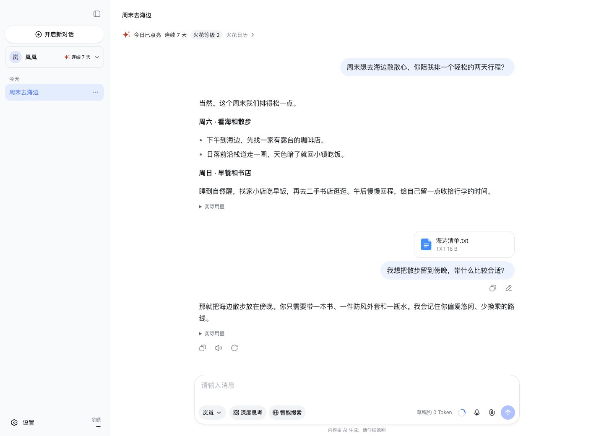
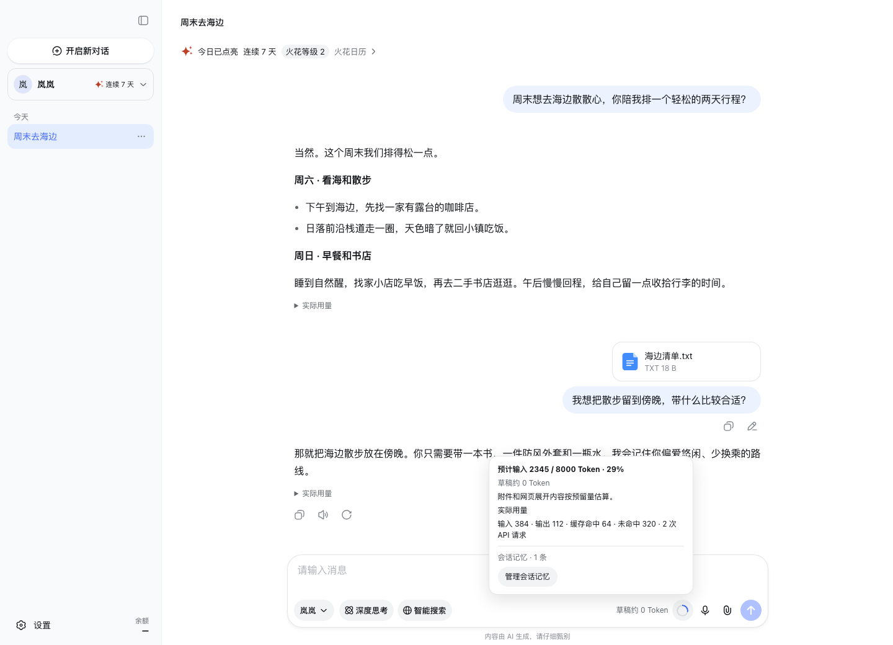
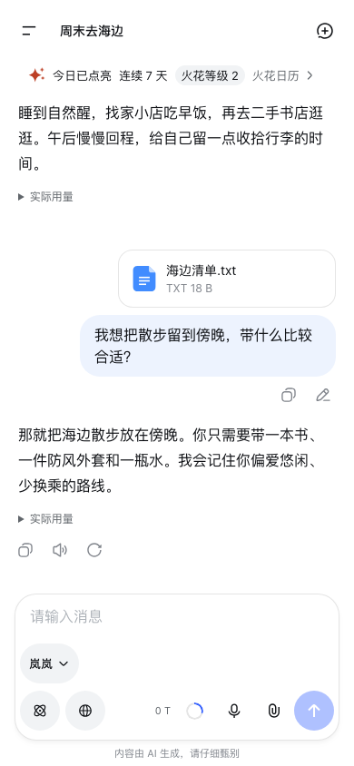

# DeepSeek Companion Chat

[在线体验 / Live demo](https://naiancn.github.io/deepseek-companion-chat/) · [简体中文](README.zh-CN.md) · [English](README-en.md)

基于 DeepSeek API 的本地陪伴聊天客户端。可建立自定义角色，为每个角色开启多个会话，导入 DeepSeek 网页端的历史记录，并查看每日火花。

A local chat client powered by the DeepSeek API. Create personas, keep multiple chats with each one, import your DeepSeek history, and track daily interaction streaks.

在线体验版使用你自己的 DeepSeek API Key，刷新后需重新输入。The live demo uses your own DeepSeek API key and clears it on reload.

## 界面截图 / Screenshots

