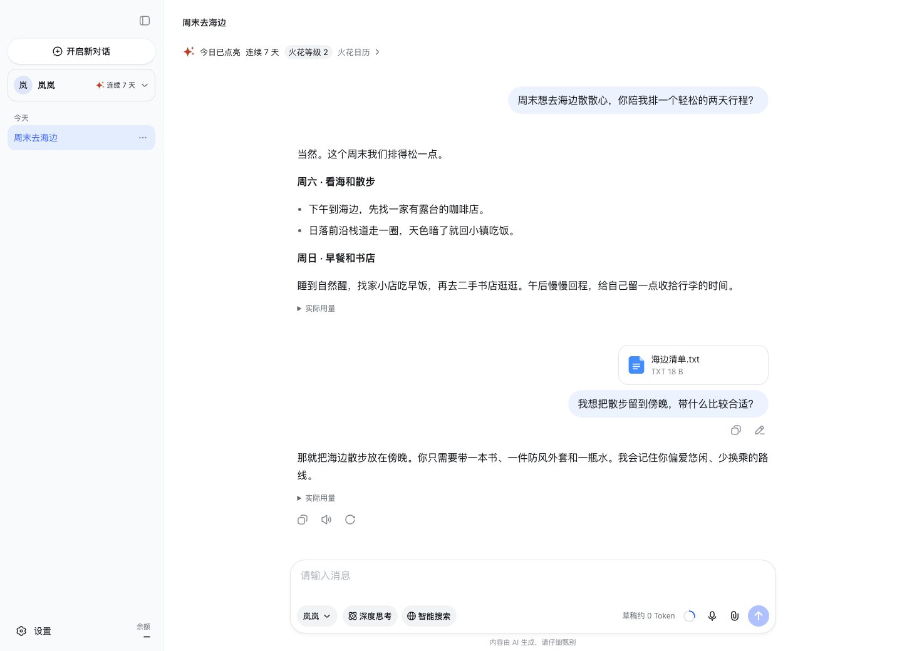
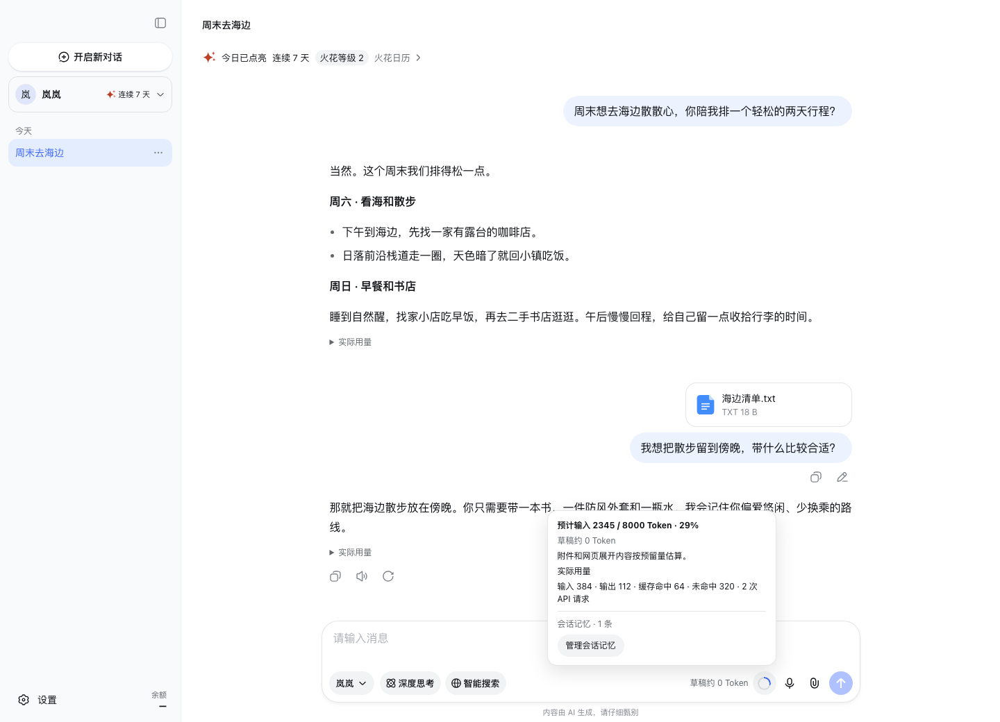
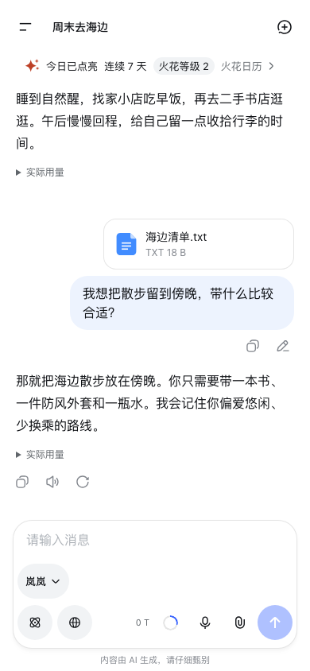

# DeepSeek Companion Chat

[在线体验](https://naiancn.github.io/deepseek-companion-chat/) · 简体中文 · [English](README-en.md)

这是一个基于 [DeepSeek 官方 chat-demo](https://github.com/deepseek-ai/chat-demo) 的本地陪伴聊天客户端。浏览器直接连接 DeepSeek API。你可以为每个角色自定义人设、保留多段对话，也可以把 DeepSeek 网页端导出的对话带进来。

## 在线体验

打开在线体验版后，在 **设置 → 数据管理** 输入自己的 DeepSeek API Key。Key 仅保留在当前页面内存中，刷新、关闭页面或点击「清除当前 API Key」后，需要重新输入。聊天请求由浏览器经 HTTPS 直发 DeepSeek。

聊天、角色和记忆仍保存在当前站点的浏览器存储中。同一 `naiancn.github.io` 域名下的不同项目路径共用同源边界。从本地版迁移时，请先导出完整备份，在体验版中恢复，再单独输入 Key。

## 界面截图







## 运行

准备 Node.js 22.12+ 和 pnpm：

```sh
pnpm install
pnpm dev
```

在项目目录运行以上命令，然后打开 [http://localhost:8090](http://localhost:8090)。首次使用时，在 **设置 → 数据管理** 填写 DeepSeek API Key。若系统限制文件监听，可用 `WATCHPACK_POLLING=1000 pnpm dev` 启动。

生成静态产物：

```sh
pnpm build
```

产物位于 `dist/`，可部署到静态服务器，也可直接打开 `dist/index.html`。直接打开时，浏览器和 API 服务需允许 `file://` 页面的存储与跨域请求。

## 功能

- 多会话、自动标题、重命名与删除；编辑提问、重新生成和切换消息分支。
- 流式回答、深度思考、智能搜索、链接阅读与来源引用；支持停止和符合条件的继续生成。
- 附件上传、粘贴与拖拽，语音输入和回复朗读；移动端录音时输入框首行显示实时频谱。
- Markdown、代码高亮、KaTeX 公式和 Mermaid 图表。
- 简体中文与英文、浅色与深色主题、移动端布局、位置设置、历史导入导出。

## 角色与火花

在 **设置 → 通用设置 → 管理角色** 创建或编辑角色。侧栏的角色下拉菜单会打开该角色最早保留的会话。侧栏只列出所选角色的对话，选择「默认」可查看未绑定角色的会话。点击「开启新对话」会沿用所选角色。也可以在输入框里选角色或更改当前会话的绑定。修改人设后，从下一次生成开始生效。

火花按角色创建时的时区计算。每天发出一条新消息并收到完整的有效回复，就记一次互动。连续 3 天点亮火花，7、14、30 和 100 天升级。每日点亮或升级时，小星依次闪动。等级越高，小星越多。

点亮后如果漏聊一天，可以从次日起连续互动三天来重燃。每段火花有一次重燃机会。漏聊日仍在日历上留空，恢复天数只计入补聊的三天。

## Token 与上下文

- 输入时，草稿 Token 估算会在圆环左侧更新。圆环显示输入预算占比，点开可查看下一轮输入估算和会话累计用量。实际用量以 API 返回为准，按请求 ID 去重。单条回复也可查看用量，旧会话可查看回复里已保存的用量。
- 在「设置 → 通用设置 → Token 预算」配置输入预算、超限行为和独立输出上限。默认输入预算为 8,000 Token，输出上限为 8,192 Token。使用到输入预算的 80% 时会提示整理上下文。默认在达到输入上限时暂停发送并保留草稿，也可设为仅提醒。
- 从输入框旁的小圆环打开「管理会话记忆」，可从旧消息里挑选记忆，也可编辑、增删候选条目。需要时可请 AI 提取候选或生成摘要，确认前可预览变化。摘要保存来源及版本，只影响匹配分支的后续请求。可应用旧版本或恢复完整上下文。
- 从「设置 → 通用设置 → 管理角色 → 角色总记忆」维护同一角色所有会话共享的记忆。会话记忆只有手动加入角色总记忆后才会共享，原会话条目仍可单独编辑。
- 侧栏底部交替显示 DeepSeek 当前余额和本机花费估算，详情可切换近 1、7、30 天。模型与 TTS 分开统计。估算采用公开人民币费率，文件解析、ASR 和节假日调整以平台账单为准。
- 浏览器用 DeepSeek V4.1 Flash 官方分词器估算 Token。附件和网页在服务端展开，协议开销也会造成估算误差。

## 数据与备份

会话、角色、头像、火花和附件原件保存在 IndexedDB，偏好保存在浏览器 localStorage。本地版也在其中保存 API Key。数据库按浏览器用户配置和站点源隔离。换浏览器、主机名或端口后，可用完整备份迁移。发送消息时，人设与当前分支上下文随请求发送给 DeepSeek。

在 **设置 → 数据管理** 可进行以下操作。

- **DeepSeek 历史导入和导出**。可直接选择包含 `manifest.json` 的导出文件夹，也可选择原始 ZIP 或将整个导出文件夹重新压缩的 ZIP。支持 v3 格式。导入前预览新增与跳过数量，可给新增会话绑定角色。会话 ID 已存在时保留本地版本。导出包含消息树和可用的本地图片原件，非图片附件仅含元数据。详见[历史归档格式](src/services/chat/history/README.md)。
- **Companion 完整备份**。保留角色、头像、绑定、火花事件、会话树、本地附件原件、角色总记忆、会话记忆、摘要版本和请求用量。恢复前先校验并预览数据数量，确认后替换这些数据并清空未发送的草稿。两种 ZIP 都不包含 API Key 或偏好设置。
- **删除所有对话**。清除会话、绑定、附件原件和草稿，保留角色、火花、API Key 和偏好。已经上传至 API 服务的文件仍在服务端。

在同一站点启动时，IndexedDB 会从 v11 或 v12 就地升级到 v13，保留原有会话和附件。若旧客户端标签页阻止升级，可关闭它后重新加载。恢复完整备份时请关闭同一站点的其他标签页。

## 开发

| 命令                | 用途                                             |
| ------------------- | ------------------------------------------------ |
| `pnpm dev`          | 启动开发服务器                                   |
| `pnpm build`        | 构建到 `dist/`                                   |
| `pnpm type`         | TypeScript 类型检查                              |
| `pnpm lint`         | oxlint 检查                                      |
| `pnpm test`         | 运行数据和业务逻辑测试                           |
| `pnpm test:browser` | 使用 Chromium 和模拟 DeepSeek 响应运行浏览器测试 |
| `pnpm format`       | oxfmt 格式化                                     |

浏览器测试首次运行前执行 `pnpm exec playwright install chromium`。

[rspack.config.ts](rspack.config.ts) 默认连接 `https://api.deepseek.com`。`createConfig({ apiOrigin, devServer })` 支持自定义 API 地址和开发服务器代理。

聊天默认使用 `deepseek-flash`，通过 Anthropic 兼容的 Messages / Files API 通信；语音使用 ASR / TTS 接口。请求使用搜索、链接阅读、标题和 `latest_reminder` 等扩展，接入服务需支持相应能力。附件实际支持的格式以服务端校验为准。

```text
src/
  app/                 应用布局、主题与全局样式
  components/          聊天、设置、Markdown 等界面组件
  features/            角色、火花、上下文管理与完整备份
  i18n/                中英文文案
  services/
    api/               API 请求、SSE 与协议类型
    chat/              会话、消息分支、本地存储与历史导入导出
    markdown/          Markdown 解析、代码高亮与图表
    speech/            录音与朗读
  utils/               通用工具
```

## 许可证

[MIT](LICENSE)。构建会将许可证复制到 `dist/LICENSE`，分发时请一并保留；第三方依赖遵循各自的许可证。
